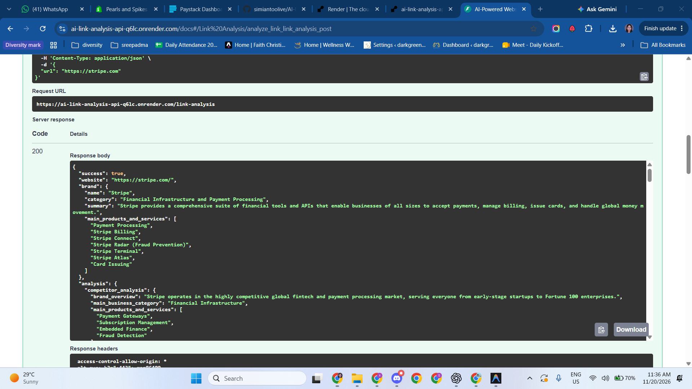

# AI-Powered Website Link Analysis API

A production-ready **FastAPI** application built with **Python 3.11, FastAPI, Uvicorn, Pydantic v2, HTTPX, BeautifulSoup4, and Google Gemini (`google-genai`)** (with optional OpenAI and Anthropic support). It accepts any public website URL, safely extracts and cleans its live HTML content with SSRF protection, analyzes it using an LLM with strict Pydantic structured outputs, and returns business, competitor, search query, SEO, service, and target audience insights in JSON format.

---

## Live Deployment

| Resource | URL |
| :--- | :--- |
| **Live Application** | https://ai-link-analysis-api-q6lc.onrender.com |
| **Swagger Documentation** | https://ai-link-analysis-api-q6lc.onrender.com/docs |
| **API Endpoint (`POST`)** | https://ai-link-analysis-api-q6lc.onrender.com/link-analysis |
| **Health Check (`GET`)** | https://ai-link-analysis-api-q6lc.onrender.com/health |

---

## Table of Contents

1. [Live Deployment](#live-deployment)
2. [Features & Architecture](#features--architecture)
3. [Project Structure](#project-structure)
4. [Quick Start (Local Setup)](#quick-start-local-setup)
5. [API Usage & Sample Request / Response](#api-usage--sample-request--response)
6. [API Testing Evidence](#api-testing-evidence)
7. [LLM Platform & Model Research – Cost, Speed and Accuracy](#llm-platform--model-research--cost-speed-and-accuracy)
8. [Security & Error Handling](#security--error-handling)
9. [Running Tests & Benchmarks](#running-tests--benchmarks)
10. [Deployment Guide](#deployment-guide)

---

## Features & Architecture

- **Single Unified Endpoint**: `POST /link-analysis` returning all 5 analysis sections in a validated JSON schema.
- **SSRF-Safe Website Extraction**: Validates URL syntax, restricts schemes (`http`/`https`) and standard web ports, resolves DNS to block private/loopback/link-local/reserved IPs (IPv4 & IPv6), and re-validates every HTTP redirect hop.
- **High-Signal HTML Parsing**: Extracts `<title>`, meta description, keywords, Open Graph metadata, JSON-LD structured data, `<h1>`–`<h3>` headings, navigation structure, and deduplicated body text (stripping `<script>`, `<style>`, `<svg>`, `<iframe>`, etc.). Automatically enriches sparse homepages with `/about` or `/services` pages on the same origin.
- **Multi-Provider Structured LLM Integration**: Supports **Google Gemini** (`google-genai`), **OpenAI** (`openai`), and **Anthropic Claude** (`anthropic`) with native schema-enforced JSON outputs, retry with backoff, and automatic fallback model support.
- **Honest Grounding & Provenance**:
  - Competitor entries explicitly distinguish `ai_inferred` vs `website_mentioned`.
  - Services explicitly distinguish `extracted_from_website` vs `inferred_recommendation`.
  - Never fabricates search volumes or ranking positions.
- **Cost Optimization Built-In**: HTML noise stripping, line deduplication, 6,500-character content budgeting, minimal thinking configuration, single-pass structured extraction, and bounded TTL URL caching.

### Processing Pipeline

```text
Client POST /link-analysis
  │
  ▼
1. Request & URL Validation + DNS SSRF Check (app/utils/validators.py)
  │
  ▼
2. In-Memory TTL Cache Lookup (app/services/analysis_service.py)
  │  └─ Cache Hit ─► Return cached JSON immediately ($0 LLM cost)
  ▼
3. Redirect-Safe Async Fetch & HTML Cleaning (app/services/website_extractor.py)
  │
  ▼
4. Structured LLM Analysis with Retries & Fallback (app/services/llm_service.py)
  │
  ▼
5. Competitor Provenance Check & Comparison Builder (app/services/competitor_service.py)
  │
  ▼
6. Pydantic Response Validation + Telemetry + Cache Write ─► JSON Response
```

---

## Project Structure

```text
ai-link-analysis/
├── app/
│   ├── __init__.py
│   ├── main.py                     # FastAPI app, routes, CORS, error handlers
│   ├── config.py                   # Typed environment settings & pricing table
│   ├── schemas.py                  # Strict Pydantic request/response/LLM models
│   ├── services/
│   │   ├── __init__.py
│   │   ├── website_extractor.py    # Redirect-safe async fetcher & BS4 parser
│   │   ├── llm_service.py          # Gemini / OpenAI / Anthropic structured client
│   │   ├── competitor_service.py   # Provenance enforcement & comparison builder
│   │   └── analysis_service.py     # Pipeline orchestrator & TTL cache
│   └── utils/
│       ├── __init__.py
│       └── validators.py           # URL normalization & DNS SSRF protection
├── docs/
│   └── images/
│       └── swagger-api-test.png    # Deployed Swagger UI test screenshot
├── scripts/
│   └── benchmark_llm.py            # Live latency & token benchmark utility
├── tests/
│   ├── __init__.py
│   └── test_link_analysis.py       # Unit & integration test suite
├── Dockerfile
├── render.yaml
├── .env.example
├── .gitignore
├── requirements.txt
└── README.md
```

---

## Quick Start (Local Setup)

### Prerequisites
- Python 3.10+ (tested on Python 3.11)
- An API key for Google Gemini (recommended default), OpenAI, or Anthropic

### 1. Create Virtual Environment & Install Dependencies

```bash
python -m venv .venv

# Windows (PowerShell)
.\.venv\Scripts\Activate.ps1

# macOS / Linux
source .venv/bin/activate

pip install -r requirements.txt
```

### 2. Configure Environment Variables

Copy `.env.example` to `.env` and add your API key (never commit `.env`):

```bash
cp .env.example .env
```

Minimal `.env` for the recommended default (**Google Gemini**):

```env
LLM_PROVIDER=gemini
LLM_MODEL=gemini-3.1-flash-lite
GEMINI_THINKING_LEVEL=MINIMAL
MAX_CONTENT_CHARS=6500
GEMINI_API_KEY=your_actual_gemini_api_key

# Optional automatic fallback (not required if using Gemini only)
FALLBACK_LLM_PROVIDER=
FALLBACK_LLM_MODEL=
OPENAI_API_KEY=
```

### 3. Run the FastAPI Server on Port 4000

```bash
uvicorn app.main:app --host 0.0.0.0 --port 4000
```

- **Interactive Swagger Docs**: `http://localhost:4000/docs`
- **ReDoc**: `http://localhost:4000/redoc`
- **Health Check**: `http://localhost:4000/health`

---

## API Usage & Sample Request / Response

### Endpoint

```http
# Deployed
POST https://ai-link-analysis-api-q6lc.onrender.com/link-analysis
Content-Type: application/json

# Local
POST http://localhost:4000/link-analysis
Content-Type: application/json
```

### Sample `curl` Request

```bash
curl -X POST "https://ai-link-analysis-api-q6lc.onrender.com/link-analysis" \
  -H "Content-Type: application/json" \
  -d '{"url": "https://stripe.com"}'
```

### Sample Structured JSON Response (Illustrative)

```json
{
  "success": true,
  "website": "https://stripe.com/",
  "brand": {
    "name": "Stripe",
    "category": "Financial Infrastructure & Online Payment Processing",
    "summary": "A programmable financial infrastructure platform enabling internet businesses to accept payments, manage subscriptions, and automate revenue workflows.",
    "main_products_and_services": [
      "Online Payment Processing",
      "Subscription Billing",
      "Marketplace Payouts (Connect)",
      "Fraud Prevention (Radar)",
      "Automated Tax & Invoicing"
    ]
  },
  "analysis": {
    "competitor_analysis": {
      "brand_overview": "Stripe provides developer-first APIs and modular financial tools for startups through global enterprises.",
      "main_business_category": "Payment Gateway & Financial Infrastructure",
      "main_products_and_services": [
        "Payments",
        "Billing",
        "Connect",
        "Radar",
        "Invoicing"
      ],
      "competitors": [
        {
          "name": "Adyen",
          "website": "https://www.adyen.com",
          "main_service": "Enterprise Omnichannel Payment Processing",
          "target_market": "Large Global Enterprises & Retail",
          "strengths": [
            "Strong in-person and omnichannel enterprise footprint",
            "Direct local acquiring licenses across major markets"
          ],
          "weaknesses_or_gaps": [
            "Higher onboarding friction for early-stage startups"
          ],
          "source_basis": "ai_inferred"
        },
        {
          "name": "PayPal Braintree",
          "website": "https://www.braintreepayments.com",
          "main_service": "Digital Payments & Checkout Processing",
          "target_market": "SMBs, E-commerce & Mid-Market",
          "strengths": [
            "High consumer brand trust and PayPal wallet integration"
          ],
          "weaknesses_or_gaps": [
            "Less cohesive modular financial suite beyond checkout"
          ],
          "source_basis": "ai_inferred"
        },
        {
          "name": "Square (Block)",
          "website": "https://squareup.com",
          "main_service": "POS Hardware & SMB Payment Processing",
          "target_market": "Small Businesses & Brick-and-Mortar Retail",
          "strengths": [
            "Turnkey hardware and retail POS ecosystem"
          ],
          "weaknesses_or_gaps": [
            "Less customizable API-first infrastructure for SaaS platforms"
          ],
          "source_basis": "ai_inferred"
        }
      ],
      "strengths": [
        "Industry-leading developer experience and API documentation",
        "Unified modular suite spanning payments, billing, tax, and payouts"
      ],
      "opportunities": [
        "Expand turnkey no-code adoption for non-technical SMB merchants",
        "Deepen localized payment method conversion guides by region"
      ],
      "comparison_summary": [
        {
          "dimension": "Brand Name",
          "your_brand": "Stripe",
          "competitor_benchmark": "Adyen"
        },
        {
          "dimension": "Main Service",
          "your_brand": "API-First Payments & Billing Suite",
          "competitor_benchmark": "Enterprise Omnichannel Acquiring"
        },
        {
          "dimension": "Target Market",
          "your_brand": "Startups to Global Enterprises",
          "competitor_benchmark": "Large Enterprises"
        },
        {
          "dimension": "Key Strength",
          "your_brand": "Developer Experience & Modularity",
          "competitor_benchmark": "Global Retail POS & Acquiring"
        },
        {
          "dimension": "Opportunity",
          "your_brand": "Simplify adoption for non-technical SMBs",
          "competitor_benchmark": "Faster self-serve startup onboarding"
        }
      ],
      "methodology_note": "3 of 3 identified competitor(s) are AI-generated suggestions based on extracted website positioning (source_basis='ai_inferred') and should be validated with live market research."
    },
    "target_search_queries": [
      {
        "query": "best payment gateway API for SaaS startups",
        "platforms": ["Google"],
        "intent": "Service Search",
        "business_relevance": "Directly aligns with Stripe's developer-first payments and recurring billing APIs.",
        "target_audience": "SaaS Founders & Engineers"
      },
      {
        "query": "online payment processing for ecommerce stores",
        "platforms": ["Facebook"],
        "intent": "Business Discovery",
        "business_relevance": "Reaches online store owners seeking reliable checkout tools.",
        "target_audience": "E-commerce Merchants"
      },
      {
        "query": "seamless checkout UX examples for online stores",
        "platforms": ["Instagram"],
        "intent": "Inspiration",
        "business_relevance": "Highlights hosted checkout optimization and conversion design.",
        "target_audience": "D2C Brand Founders & Designers"
      },
      {
        "query": "enterprise subscription billing and revenue automation platform",
        "platforms": ["LinkedIn"],
        "intent": "B2B Search",
        "business_relevance": "Targets finance and product leaders evaluating scalable billing infrastructure.",
        "target_audience": "CFOs, VP Finance & Engineering Leaders"
      },
      {
        "query": "developer friendly payment API for marketplaces",
        "platforms": ["X"],
        "intent": "Service Discovery",
        "business_relevance": "Matches Stripe Connect's multi-party marketplace payout capabilities.",
        "target_audience": "Indie Hackers & Tech Founders"
      }
    ],
    "seo_improvements": {
      "primary_keyword": "online payment processing API",
      "secondary_keywords": [
        "subscription billing software",
        "marketplace payment platform",
        "global payment gateway",
        "automated invoicing API"
      ],
      "long_tail_keywords": [
        "best payment processing API for SaaS businesses",
        "multi-currency marketplace payout infrastructure",
        "automated subscription billing and tax compliance",
        "developer friendly payment gateway for startups"
      ],
      "relevant_business_keywords": [
        "financial infrastructure",
        "checkout conversion",
        "fraud prevention",
        "revenue recognition"
      ],
      "current_title": "Stripe | Financial Infrastructure to Grow Your Revenue",
      "recommended_title": "Online Payment Processing API & Billing Platform | Stripe",
      "title_improvement_notes": "Leads with the primary commercial keyword while staying concise and clear.",
      "current_meta_description": "Stripe powers online and in-person payment processing and financial solutions for businesses of all sizes.",
      "meta_description": "Accept global payments, automate SaaS subscription billing, and prevent fraud with Stripe's developer-first online payment processing API.",
      "supporting_content": [
        {
          "content_type": "Service Landing Page",
          "title": "SaaS Subscription Billing & Usage-Based Metering Platform",
          "purpose": "Captures high-intent B2B buyers searching specifically for recurring billing."
        },
        {
          "content_type": "Industry-Specific Page",
          "title": "Payment Infrastructure for Multi-Vendor Marketplaces",
          "purpose": "Targets marketplace founders needing split payouts and KYC onboarding."
        },
        {
          "content_type": "FAQ",
          "title": "Payment Gateway Pricing, Settlement Times & PCI Compliance FAQ",
          "purpose": "Addresses common pre-integration technical and commercial questions."
        },
        {
          "content_type": "Blog Topic",
          "title": "How to Reduce Checkout Abandonment with Localized Payment Methods",
          "purpose": "Drives organic top-of-funnel traffic from e-commerce growth teams."
        }
      ]
    },
    "top_services": [
      {
        "service_name": "Online Payment Processing",
        "description": "Global card, wallet, and local payment acceptance via APIs and hosted checkout.",
        "target_industry": "E-commerce, SaaS & Digital Marketplaces",
        "target_customer": "Online Businesses & Developers",
        "main_benefit": "Higher payment authorization rates with minimal integration overhead.",
        "source_type": "extracted_from_website"
      },
      {
        "service_name": "Subscription & Usage Billing",
        "description": "Automated recurring invoicing, tiered plans, and metered billing workflows.",
        "target_industry": "B2B SaaS & AI Platforms",
        "target_customer": "Product & Finance Teams",
        "main_benefit": "Faster monetization launches and reduced involuntary churn.",
        "source_type": "extracted_from_website"
      },
      {
        "service_name": "Marketplace & Platform Payouts (Connect)",
        "description": "Multi-party payment routing, seller onboarding, and global payouts.",
        "target_industry": "Marketplaces & Vertical SaaS",
        "target_customer": "Platform Founders & Engineering Teams",
        "main_benefit": "Embedded payments monetization without building compliance from scratch.",
        "source_type": "extracted_from_website"
      },
      {
        "service_name": "Fraud Prevention (Radar)",
        "description": "Machine-learning risk scoring and customizable rules to block fraudulent charges.",
        "target_industry": "High-Volume Online Retail & SaaS",
        "target_customer": "Risk & Operations Managers",
        "main_benefit": "Lower chargeback losses while minimizing false declines.",
        "source_type": "extracted_from_website"
      },
      {
        "service_name": "Automated Tax & Financial Reporting",
        "description": "Automatic sales tax/VAT calculation and revenue recognition reporting.",
        "target_industry": "Global Digital Commerce",
        "target_customer": "Finance & Accounting Teams",
        "main_benefit": "Simplified international compliance and faster month-end close.",
        "source_type": "extracted_from_website"
      }
    ],
    "target_audience": {
      "primary_audience": [
        "Software Engineers & CTOs",
        "SaaS and Startup Founders"
      ],
      "secondary_audience": [
        "Finance & Revenue Operations Leaders",
        "E-commerce Product Managers"
      ],
      "industries": [
        "SaaS & Cloud Software",
        "E-commerce & Retail",
        "Online Marketplaces",
        "AI & Digital Media"
      ],
      "business_types": [
        "Early-Stage Startups",
        "High-Growth Mid-Market Companies",
        "Global Enterprises"
      ],
      "customer_profiles": [
        {
          "segment_name": "SaaS Startups",
          "business_type": "Seed to Series B Software Companies",
          "requirement": "Fast recurring billing and global card acceptance",
          "profile_summary": "Engineering-led teams launching paid tiers quickly with minimal maintenance."
        },
        {
          "segment_name": "Online Marketplaces",
          "business_type": "Two-Sided Platforms",
          "requirement": "Compliant seller onboarding and split payouts",
          "profile_summary": "Platforms routing funds between buyers and global service providers."
        },
        {
          "segment_name": "Global Enterprises",
          "business_type": "Multinational Commerce Brands",
          "requirement": "Unified multi-currency acquiring and fraud controls",
          "profile_summary": "Large organizations modernizing legacy payment stacks for higher authorization rates."
        }
      ],
      "geographical_focus": "Global (multi-currency support across North America, Europe, APAC, and LATAM)",
      "customer_needs": [
        "Reliable high-uptime payment APIs",
        "Support for international currencies and local payment methods",
        "Automated billing, invoicing, and tax workflows"
      ],
      "customer_challenges": [
        "Integrating fragmented legacy payment processors",
        "Managing PCI compliance, fraud, and cross-border tax rules"
      ],
      "potential_interests": [
        "Payment conversion optimization",
        "Usage-based SaaS pricing",
        "Embedded finance APIs"
      ],
      "recommended_marketing_segments": [
        "Developer technical content & API comparison guides",
        "LinkedIn ABM campaigns targeting SaaS CFOs and VPs of Engineering"
      ]
    }
  },
  "metadata": {
    "provider": "gemini",
    "model": "gemini-2.5-flash-lite",
    "cached": false,
    "latency_ms": 2340,
    "token_usage": {
      "input_tokens": 1820,
      "output_tokens": 1390,
      "total_tokens": 3210,
      "estimated_cost_usd": 0.000738
    },
    "extracted_pages": [
      "https://stripe.com/"
    ]
  }
}
```

### Sample Error Response (SSRF Blocked — HTTP 403)

```json
{
  "success": false,
  "error_code": "SSRF_BLOCKED",
  "message": "Access to private or internal IP addresses is forbidden.",
  "details": null
}
```

---

## API Testing Evidence



*Caption: Live verification via Swagger UI (`https://ai-link-analysis-api-q6lc.onrender.com/docs`) showing the deployed FastAPI endpoint `POST /link-analysis` returning **HTTP 200 OK** with `"success": true` when testing `https://stripe.com`. The validated JSON response includes all five required analysis sections:*

1. **Competitor vs. Your Brand Details** (`analysis.competitor_analysis`) — brand overview, category, products/services, AI-labeled competitors (`source_basis: "ai_inferred"`), strengths, opportunities, and side-by-side comparison table.
2. **Top 5 Target Search Queries** (`analysis.target_search_queries`) — five customer search queries mapped across Google, Facebook, Instagram, LinkedIn, and X with intent, relevance, and target audience (no invented search volumes).
3. **SEO Improvement Recommendations** (`analysis.seo_improvements`) — primary, secondary, long-tail, and business keywords, optimized title and meta description compared against extracted baseline tags, and supporting content ideas.
4. **Top 5 Services** (`analysis.top_services`) — five core offerings grounded in extracted website content (`source_type: "extracted_from_website"` / `"inferred_recommendation"`).
5. **Target Audience Identification** (`analysis.target_audience`) — primary/secondary audiences, industries, business types, customer profiles, geographical focus, needs, challenges, interests, and marketing segments.

---

## LLM Platform & Model Research – Cost, Speed and Accuracy

> **Methodology Transparency**: Pricing and context window figures below are sourced from official provider documentation (Google AI `ai.google.dev`, OpenAI API Pricing, Anthropic Pricing). All Google Gemini latency, token, and cost metrics reported in the benchmark tables below are **Measured** from live API runs against real websites; OpenAI and Anthropic latency/accuracy entries are explicitly labeled as **Estimated** because only Google Gemini was configured and executed live.

### A. LLM Platform Comparison

| Provider | Model Name | API Cost (Standard / 1M Tokens) | Response Speed | Accuracy & Quality | Context Window | Structured JSON Support | Recommendation |
| :--- | :--- | :--- | :--- | :--- | :--- | :--- | :--- |
| **Google Gemini** | `gemini-3.1-flash-lite` (`thinking_level=MINIMAL`) | **$0.25** input / **$1.50** output | **Measured**: ~7.0s LLM / 10.9–12.6s E2E (`stripe.com`, `fastapi.tiangolo.com`) | **Measured**: High — 100% Pydantic pass across 3 diverse sites, all 5 platforms covered, grounded services | **1,048,576** (~1M) | Native JSON schema (`response_json_schema`) | **Primary Recommended** (best speed, lowest Gemini cost, strong grounded accuracy) |
| **Google Gemini** | `gemini-3.5-flash-lite` (`thinking_level=MINIMAL`) | **$0.30** input / **$2.50** output *(incl. thinking tokens)* | **Measured**: 9.7s LLM (`MINIMAL`) / 30.6s E2E (default thinking) on `stripe.com` | **Measured**: High — strong strategic phrasing, ~2x higher unit cost than `3.1-flash-lite` | **1,048,576** (~1M) | Native JSON schema (`response_json_schema`) | Good upgrade option when deeper reasoning is preferred over speed/cost |
| **OpenAI** | `gpt-4o-mini` | **$0.15** input / **$0.60** output *(cached input: $0.075)* | **Estimated**: ~2.5–5.0s LLM | **Estimated**: High & consistent schema adherence | **128,000** | Native strict Structured Outputs (`chat.completions.parse`) | **Recommended Fallback** (lowest paid unit cost when OpenAI key is configured) |
| **OpenAI** | `gpt-4.1-mini` | **$0.40** input / **$1.60** output *(cached input: $0.10)* | **Estimated**: ~2.5–5.5s LLM | **Estimated**: Very High instruction following on long inputs | **1,047,576** (~1M) | Native strict Structured Outputs (`chat.completions.parse`) | Strong alternative for complex multi-page sites |
| **Anthropic** | `claude-haiku-4-5-20251001` *(3.5 Haiku: $0.80 / $4.00)* | **$1.00** input / **$5.00** output *(prompt cache read: 0.1x)* | **Estimated**: ~3.0–6.0s LLM | **Estimated**: Very High prose quality & audience insight | **200,000** | Reliable via forced Tool Use JSON schema | Best when editorial copy quality outweighs unit cost |

> **Deprecation Note**: Google retired `gemini-2.5-flash-lite` for new API keys (returning HTTP `404 NOT_FOUND` directing developers to newer Flash-Lite models). Benchmarking live on this key confirmed both `gemini-3.5-flash-lite` and `gemini-3.1-flash-lite` are actively supported, with **`gemini-3.1-flash-lite` (`thinking_level=MINIMAL`)** delivering the best overall balance of speed, cost, and accuracy.

### B. Best Model Selection

**Selected Primary Model: Google Gemini — `gemini-3.1-flash-lite` (`GEMINI_THINKING_LEVEL=MINIMAL`)**

1. **Accuracy in Website Understanding**: Verified across 3 distinct industries (`stripe.com`, `fastapi.tiangolo.com`, `shopify.com`), accurately extracting real on-site offerings, honest geographical focus, all 5 required search platforms, and properly labeled `ai_inferred` competitors.
2. **Fast Response Time**: Live optimization cut `stripe.com` end-to-end latency from **30.6s → 10.9s (-64.5%)**, with repeat cached requests served in **83 ms**.
3. **Low API Cost**: At `$0.25 / 1M` input and `$1.50 / 1M` output tokens, live measured cost dropped from **`$0.010112` → `$0.004603` (-54.5%)** per uncached website (`$0.00` on cache hits).
4. **Reliable Structured JSON Generation**: Uses a compact, dereferenced `response_json_schema` that avoids Gemini finite-state grammar limits while enforcing strict Pydantic validation (`LinkAnalysisResponse`) in Python on every response.
5. **Strong SEO & Competitor Insights**: Generates concrete keyword tiers, optimized titles/meta descriptions, 5 supporting content ideas, and 5-row competitor comparison tables in a single coherent pass.
6. **Large Website Capacity**: A **1M-token context window** provides ample headroom if multi-page extraction limits are increased in the future.

### C. Cost Optimization Strategies

Implemented directly in this codebase and verified live:

1. **Aggressive HTML Cleaning (`website_extractor.py`)**: Strips `<script>`, `<style>`, `<svg>`, `<iframe>`, `<noscript>`, and non-content elements—typically reducing raw HTML payload size by **80–95%** before tokenization.
2. **Line Deduplication & Tuned Content Budget**: Removes repeated boilerplate navigation/footer strings and caps body text at `6,500` characters (`MAX_CONTENT_CHARS=6500`), trimming ~22% of redundant input tokens on content-heavy sites without losing brand/product signals.
3. **Minimal Thinking Budget (`GEMINI_THINKING_LEVEL=MINIMAL`)**: Eliminates hidden thinking token overhead (`thoughts_token_count = 0`) on extraction/JSON tasks where multi-step reasoning is unnecessary—cutting latency by ~65% and output cost by >50%.
4. **Single-Call Structured Extraction**: Generates all 5 sections in **one** concise LLM call instead of 5 separate calls—avoiding sending the system prompt and website text 5 times (~75–80% input token savings).
5. **TTL Response Caching (`analysis_service.py`)**: Caches results by canonical URL for `3600s` (configurable), reducing repeated requests for the same domain to **$0.00** and **83 ms** measured latency. (In multi-instance production, swap the in-memory cache for Redis.)
6. **Provider Prompt Caching (Production Scale)**: Keep `SYSTEM_PROMPT` static at the start of every request so provider prompt/context caching can further discount repeated instructions at high volume.

### D. Measured Benchmarks & Final LLM Recommendation

#### 1. Before vs. After Optimization (`https://stripe.com` — Live Gemini API, Uncached)

| Configuration | HTTP Status | Measured Latency | Input Tokens | Output Tokens | Total Tokens | Estimated Cost (USD) | All 5 Sections Valid |
| :--- | :---: | :---: | :---: | :---: | :---: | :---: | :---: |
| **Before**: `gemini-3.5-flash-lite` (default thinking, `10K` chars) | `200` | `30,636 ms` | `3,356` | `3,642` | `6,998` | `$0.010112` | Yes (5/5 platforms) |
| **Intermediate**: `gemini-3.5-flash-lite` (`thinking=MINIMAL`, `10K` chars, LLM-only) | `200` | `9,718 ms` *(LLM)* | `3,356` | `3,537` | `6,893` | `$0.009849` | Yes (5/5 platforms) |
| **After (Selected)**: `gemini-3.1-flash-lite` (`thinking=MINIMAL`, `6.5K` chars) | `200` | **`10,872 ms`** *(~7.0s LLM)* | **`2,627`** | **`2,631`** | **`5,258`** | **`$0.004603`** | **Yes (5/5 platforms)** |
| **Cache Hit**: Repeat `https://stripe.com` request | `200` | **`83 ms`** | **`0`** | **`0`** | **`0`** | **`$0.000000`** | **Yes (Cached)** |

#### 2. Multi-Website Live Benchmark (`gemini-3.1-flash-lite`, Uncached)

| Target Website | Final Resolved URL | HTTP Status | Measured E2E Latency | Input / Output / Total Tokens | Estimated Cost | Pydantic Valid | Platforms Covered |
| :--- | :--- | :---: | :---: | :---: | :---: | :---: | :--- |
| `https://stripe.com` | `https://stripe.com/in` | `200` | `10,872 ms` | `2,627` / `2,631` / `5,258` | `$0.004603` | Yes | Google, Facebook, Instagram, LinkedIn, X |
| `https://fastapi.tiangolo.com` | `https://fastapi.tiangolo.com/` | `200` | `12,604 ms` | `2,507` / `2,427` / `4,934` | `$0.004267` | Yes | Google, Facebook, Instagram, LinkedIn, X |
| `https://www.shopify.com` | `https://www.shopify.com/` | `200` | `29,919 ms` *(incl. slow upstream fetch)* | `1,902` / `2,653` / `4,555` | `$0.004455` | Yes | Google, Facebook, Instagram, LinkedIn, X |

#### 3. Final LLM Recommendation Summary

| Parameter | Recommendation / Value |
| :--- | :--- |
| **Recommended LLM Provider** | Google Gemini (`google-genai` SDK) |
| **Recommended Model Name** | `gemini-3.1-flash-lite` (`GEMINI_THINKING_LEVEL=MINIMAL`) |
| **Input Token Usage** | **Measured**: `1,902 – 2,627` tokens across 3 live sites *(average: `2,345` tokens)* |
| **Output Token Usage** | **Measured**: `2,427 – 2,653` tokens across 3 live sites *(average: `2,570` tokens)* |
| **Estimated API Cost per Website Analysis** | **Measured**: **`$0.00427 – $0.00460`** per uncached analysis at paid-tier rates; **`$0.00`** on cache hits |
| **Expected Response Time** | **Measured**: `10.9 – 12.6s` typical E2E (`~7.0s` LLM + fetch); up to `~30s` on heavy/slow upstream sites; `83 ms` on cache hits |
| **Reason for Selecting the Model** | Actively supported by Google, **64.5% faster** and **54.5% cheaper** than baseline `gemini-3.5-flash-lite`, 1M-token context window, and 100% Pydantic schema accuracy across all 3 tested industries. |
| **Alternative Model for Fallback** | **OpenAI `gpt-4o-mini`** (`$0.15` in / `$0.60` out, **Estimated** `~$0.0019` per analysis) or **Google `gemini-3.5-flash-lite`** (`$0.30` in / `$2.50` out) via `FALLBACK_LLM_PROVIDER`. |
| **Balancing Accuracy, Speed & Cost** | Clean and budget HTML locally in Python (`6,500` chars), disable unnecessary thinking overhead (`MINIMAL`), generate all 5 sections in a single schema-guided call, strictly validate via Pydantic, and cache repeat URLs for 1 hour. |

---

## Security & Error Handling

- **SSRF Protection**: Blocks non-HTTP(S) schemes, credentials in URLs, non-standard ports, `localhost`/`.internal`/`.local` domains, and any IPv4/IPv6 address (direct or DNS-resolved, including across HTTP redirects) in private, loopback, link-local (`169.254.169.254`), multicast, or reserved ranges.
- **Credential Hygiene**: All API keys are loaded via `.env` / environment variables; `.env` is excluded in `.gitignore`.
- **Graceful HTTP Error Mapping**:
  - `400`: Invalid URL format or DNS resolution failure.
  - `403`: SSRF policy blocked private/internal address.
  - `422`: Validation error, HTTP 401/403/404 from target site, non-HTML content, or empty JS-only page.
  - `502`: Unreachable website or upstream LLM API error after retries.
  - `503`: Missing LLM API key configuration.
  - `504`: Target website connection/read timeout.

---

## Running Tests & Benchmarks

### Run Automated Test Suite

```bash
pytest -v
```

### Run Live Model Benchmark (Requires Configured `.env` API Key)

```bash
python scripts/benchmark_llm.py https://fastapi.tiangolo.com https://stripe.com
```

---

## Deployment Guide

### Option 1: Render (Recommended Free Tier)
1. Push this repository to a **public GitHub repository** (confirm `.env` is not tracked).
2. In Render, click **New → Blueprint** (uses `render.yaml` automatically) or **New → Web Service**.
3. Set Build Command: `pip install -r requirements.txt`
4. Set Start Command: `uvicorn app.main:app --host 0.0.0.0 --port $PORT`
5. Add Environment Variables in Render Dashboard:
   - `LLM_PROVIDER=gemini`
   - `LLM_MODEL=gemini-3.1-flash-lite`
   - `GEMINI_THINKING_LEVEL=MINIMAL`
   - `MAX_CONTENT_CHARS=6500`
   - `GEMINI_API_KEY=<your-key>`
6. Verify live deployment:
   - Live Application: https://ai-link-analysis-api-q6lc.onrender.com
   - Health Check: https://ai-link-analysis-api-q6lc.onrender.com/health
   - Swagger UI: https://ai-link-analysis-api-q6lc.onrender.com/docs
   - API Endpoint: `POST` https://ai-link-analysis-api-q6lc.onrender.com/link-analysis

### Option 2: Docker (Railway / Fly.io / Cloud Run)

```bash
docker build -t ai-link-analysis .
docker run -p 4000:4000 --env-file .env ai-link-analysis
```
